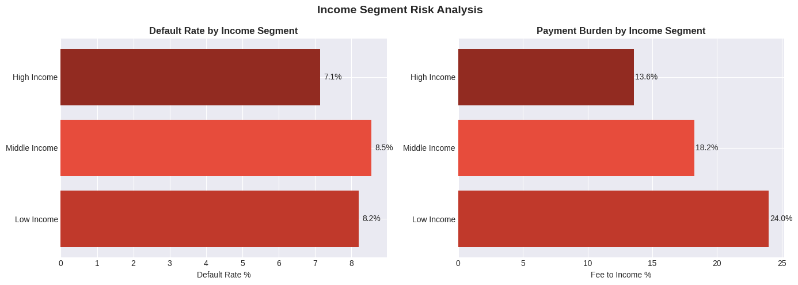
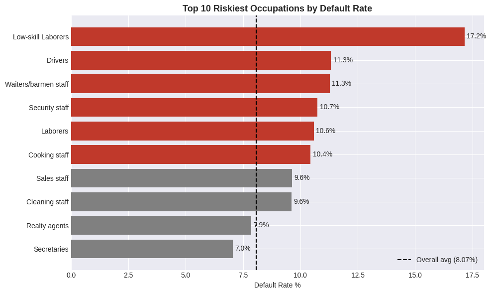
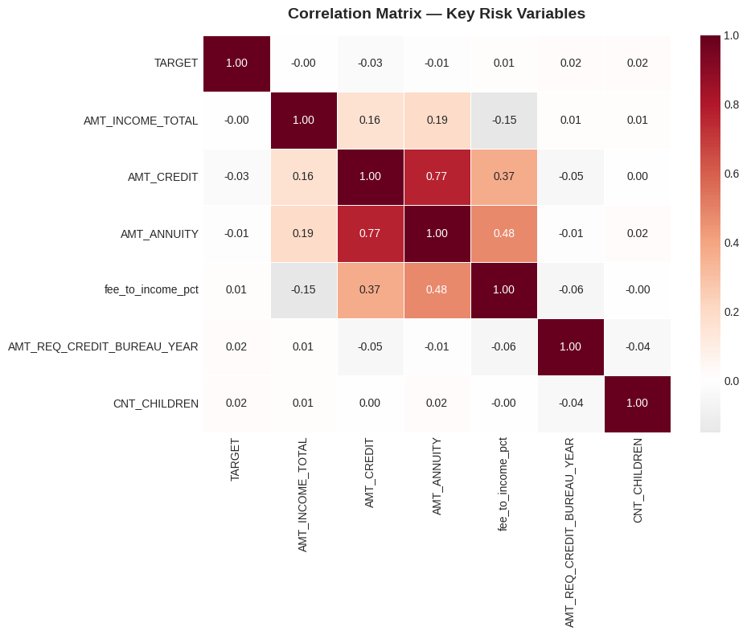

# Borrower Default Risk Analytics on Home Credit Data

[](https://www.python.org/)
[](https://www.sqlite.org/)
[](https://pandas.pydata.org/)
[](https://powerbi.microsoft.com/)
[](LICENSE)

An end-to-end descriptive and diagnostic credit risk analytics project evaluating **307,511 real-world loan applications** from Home Credit. Designed for **Data Analyst, BI Analyst, and Credit Risk Analyst** workflows, this project combines **Python (Pandas)** data preparation, complex **SQL (SQLite)** queries with window functions and CTEs, and an interactive **Power BI** executive dashboard to uncover structural repayment vulnerabilities and recommend actionable underwriting policy thresholds.

> **Note:** This project focuses strictly on **exploratory data analysis, SQL segmentation, borrower diagnostic profiling, and BI reporting**. It deliberately excludes machine learning predictive modeling in favor of explainable, business-driven portfolio analytics.

---

## Table of Contents
1. [Business Problem & Analytical Objectives](#1-business-problem--analytical-objectives)
2. [Dataset Overview & Attribution](#2-dataset-overview--attribution)
3. [Technologies Used](#3-technologies-used)
4. [Repository Architecture](#4-repository-architecture)
5. [Data Quality, Cleaning & Feature Engineering](#5-data-quality-cleaning--feature-engineering)
6. [SQL Analysis & Diagnostic Queries](#6-sql-analysis--diagnostic-queries)
7. [Exploratory Data Analysis & Visual Insights](#7-exploratory-data-analysis--visual-insights)
8. [Power BI Executive Dashboard](#8-power-bi-executive-dashboard)
9. [Key Empirical Findings](#9-key-empirical-findings)
10. [Actionable Underwriting Recommendations](#10-actionable-underwriting-recommendations)
11. [Installation & Execution Guide](#11-installation--execution-guide)
12. [Limitations & Analytical Roadmap](#12-limitations--analytical-roadmap)
13. [License & Attribution](#13-license--attribution)

---

## 1. Business Problem & Analytical Objectives

### Business Problem
A non-bank financial institution providing consumer credit to underbanked applicants experiences an elevated portfolio default rate of **8.07%** (significantly above typical retail banking benchmarks of 5.0%–7.0%). Blanket underwriting criteria fail to differentiate between safe applicants and borrowers facing structural debt service distress. 

### Analytical Objectives
1. **Benchmark Portfolio Quality:** Quantify default rate distributions and identify class imbalance across 307,511 active applications.
2. **Diagnose Payment Burden:** Measure the impact of monthly installment size relative to annual income (`fee_to_income_pct`) across distinct income strata.
3. **Isolate High-Risk Borrower Segments:** Leverage SQL window functions (`RANK()`) and CTEs to identify occupation tiers and credit-seeking behaviors that drive disproportionate credit losses.
4. **Formulate Underwriting Policies:** Provide concrete, quantified credit caps, risk-based pricing premiums, and monitoring metrics for the Credit Risk Committee.

---

## 2. Dataset Overview & Scope

* **Source:** [Home Credit Default Risk (Kaggle Competition)](https://www.kaggle.com/competitions/home-credit-default-risk)
* **Primary Table:** `application_train.csv` (307,511 rows × 122 columns)
* **Target Metric:** `TARGET` (Binary: `0` = Loan repaid on time, `1` = Client encountered payment difficulty / defaulted)
* **Monetary Units:** All monetary values (`AMT_INCOME_TOTAL`, `AMT_CREDIT`, `AMT_ANNUITY`, `AMT_GOODS_PRICE`) represent raw dataset currency units as provided in the source competition dataset.
* **Author:** Mridul Rajgaria

---

## 3. Technologies Used

| Technology | Purpose | Key Applications |
| :--- | :--- | :--- |
| **Python 3.11+** | Data Wrangling & Ingestion | Data pipelines, missing-value profiling, data formatting |
| **Pandas & NumPy** | Exploratory Data Analysis | Aggregations, quantile binning, ratio calculations |
| **SQLite (SQL)** | Relational Segmentation | CTEs, window functions (`RANK`, `DENSE_RANK`), aggregations |
| **Power BI** | Executive BI Reporting | Multi-page dashboards, DAX measures, KPI cards, visual drilldowns |
| **Matplotlib & Seaborn** | Statistical Plotting | Distribution heatmaps, styled comparative bar charts |

---

## 4. Repository Architecture

```text
Borrower-Default-Risk-Analytics-on-Home-Credit-Data/
├── README.md                           # Main portfolio documentation & project overview
├── requirements.txt                    # Minimal Python dependencies (no ML)
├── LICENSE                             # MIT Open Source License & attribution notices
├── .gitignore                          # Excludes raw CSV data, caches, and local environments
├── data/
│   └── README.md                       # Dataset source, schema details, and download guide
├── notebooks/
│   └── credit_risk_analysis.ipynb      # Clean 10-section Jupyter exploratory notebook
├── sql/
│   └── credit_risk_analysis.sql        # Dedicated production-grade SQL script (SQLite compatible)
├── dashboard/
│   ├── credit_risk_dashboard.pbix      # Power BI report file with embedded VertiPaq model
│   └── README.md                       # Power BI visual specs, DAX calculations & data refresh guide
├── reports/
│   └── key_findings.md                 # Executive findings & underwriting policy recommendations
└── images/
    ├── dashboard_page1_overview.png           # Power BI Page 1 overview visualization
    ├── dashboard_page2_behavioral_signals.png # Power BI Page 2 behavioral signals visualization
    ├── income_segment_risk_analysis.png       # Matplotlib income vs default & fee analysis
    ├── correlation_matrix.png                 # Heatmap of key credit risk variables
    └── top_riskiest_occupations.png           # Top 10 riskiest occupations bar chart
```

---

## 5. Data Quality, Cleaning & Feature Engineering

### Missing-Value Diagnostic
* **67 of 122 columns** (54.9%) exhibit missing values.
* Housing details (`COMMONAREA_MEDI`, `NONLIVINGAPARTMENTS_MODE`, `FLOORSMIN_AVG`) exceed **65% to 70% missingness**, reflecting that many underbanked borrowers do not occupy standardized apartment housing.
* Core underwriting features (`AMT_INCOME_TOTAL`, `AMT_CREDIT`, `TARGET`) contain **0 missing values**, enabling robust population-level analysis.

### Sentinel Values & Outliers
* **Sentinel in `DAYS_EMPLOYED`:** Contains the value `365,243` days (~1,000 years), an administrative code denoting pensioners and unemployed applicants.
* **Income Outliers:** Gross annual income ranges up to 117,000,000 units against a median of 147,150 units. To prevent distortions, analysis leverages categorizations (`Low`, `Middle`, `High`).

### Derived Financial Metrics
* **`fee_to_income_pct`**: Monthly installment burden computed as `(AMT_ANNUITY / AMT_INCOME_TOTAL) * 100`.
* **`income_segment`** (denominated in currency units):
  * Low Income: `< 100,000` (20.7% of borrowers)
  * Middle Income: `100,000 – 200,000` (50.7% of borrowers)
  * High Income: `> 200,000` (28.6% of borrowers)
* **`inquiries_segment`**: Tiers based on annual credit bureau inquiries (`0`, `1–3`, `4–6`, `7+`).

---

## 6. SQL Analysis & Diagnostic Queries

All SQL queries are organized in [`sql/credit_risk_analysis.sql`](sql/credit_risk_analysis.sql) and execute directly against SQLite.

### Highlight Query 1: Top Riskiest Occupations (CTE + Window Functions)
```sql
WITH occupation_summary AS (
    SELECT 
        OCCUPATION_TYPE AS occupation,
        COUNT(1) AS total_borrowers,
        SUM(TARGET) AS defaults,
        ROUND(AVG(TARGET) * 100.0, 2) AS default_rate_pct,
        ROUND(AVG(AMT_ANNUITY / NULLIF(AMT_INCOME_TOTAL, 0)) * 100.0, 2) AS avg_fee_to_income_pct
    FROM applications
    WHERE OCCUPATION_TYPE IS NOT NULL
    GROUP BY OCCUPATION_TYPE
    HAVING COUNT(1) >= 500
),
ranked_occupations AS (
    SELECT 
        occupation,
        total_borrowers,
        defaults,
        default_rate_pct,
        avg_fee_to_income_pct,
        RANK() OVER (ORDER BY default_rate_pct DESC) AS risk_rank
    FROM occupation_summary
)
SELECT *
FROM ranked_occupations
WHERE risk_rank <= 10
ORDER BY risk_rank ASC;
```

### Highlight Query 2: Multi-Dimensional Risk Matrix (Income × Credit Bureau Queries)
```sql
WITH multi_risk AS (
    SELECT 
        CASE 
            WHEN AMT_INCOME_TOTAL < 100000 THEN 'Low Income'
            WHEN AMT_INCOME_TOTAL <= 200000 THEN 'Middle Income'
            ELSE 'High Income'
        END AS income_tier,
        CASE 
            WHEN AMT_REQ_CREDIT_BUREAU_YEAR = 0 THEN '0 Inquiries'
            WHEN AMT_REQ_CREDIT_BUREAU_YEAR BETWEEN 1 AND 3 THEN '1-3 Inquiries'
            WHEN AMT_REQ_CREDIT_BUREAU_YEAR BETWEEN 4 AND 6 THEN '4-6 Inquiries'
            ELSE '7+ Inquiries'
        END AS bureau_inquiries_tier,
        TARGET
    FROM applications
    WHERE AMT_INCOME_TOTAL > 0 
      AND AMT_REQ_CREDIT_BUREAU_YEAR IS NOT NULL
)
SELECT 
    income_tier,
    bureau_inquiries_tier,
    COUNT(1) AS total_clients,
    ROUND(AVG(TARGET) * 100.0, 2) AS default_rate_pct
FROM multi_risk
GROUP BY income_tier, bureau_inquiries_tier
ORDER BY income_tier, default_rate_pct DESC;
```

---

## 7. Exploratory Data Analysis & Visual Insights

### Default Rate & Payment Burden by Income Segment

* Low-income borrowers bear an average **fee-to-income ratio of 23.99%**, compared to only **13.58%** for high-income applicants.
* Middle-income applicants generate the largest nominal volume of defaults (13,326 defaults; 8.55% default rate).

### Top Riskiest Occupations

* `Low-skill Laborers` display the highest default rate across the entire portfolio at **17.15%** (more than 2x the 8.07% benchmark).
* `Drivers` (**11.33%**) and `Waiters/barmen staff` (**11.28%**) exhibit elevated default rates driven by volatile disposable income.

### Correlation Matrix of Key Risk Variables

* Linear correlations with `TARGET` are all close to zero (e.g. `AMT_INCOME_TOTAL`: -0.00, `AMT_CREDIT`: -0.03).
* **Implication:** Credit default cannot be detected using single-variable linear thresholds; it emerges from compounding interactions between debt service burden, job stability, and recent credit-seeking urgency.

---

## 8. Power BI Executive Dashboard

The interactive Power BI file ([`dashboard/credit_risk_dashboard.pbix`](dashboard/credit_risk_dashboard.pbix)) delivers immediate portfolio visibility across two structured views:

> **Note on Visual Previews:** The figures below are **illustrative layout previews** reconstructed directly from the Power BI report specifications, data model schema, and underlying portfolio metrics. The live, interactive report is preserved in [`dashboard/credit_risk_dashboard.pbix`](dashboard/credit_risk_dashboard.pbix). All monetary quantities reflect dataset currency units as provided in the source data.

### Page 1: Credit Risk Overview

* **KPI Header:** Tracks Total Applicants (`307,511`), Overall Default Rate (`8.07%`), and Average Payment Burden (`18.1%`).
* **Visuals:** Income segment default rates, payment burden breakdown, and target distribution donut chart.

### Page 2: Behavioral Risk Signals

* **Risk Stratification:** 10 riskiest occupations mapped against the 8.07% portfolio benchmark.
* **Credit Inquiries:** Default rates grouped by annual bureau inquiries (`0`, `1–3`, `4–6`, `7+`).

> For full DAX calculations and data refresh steps, refer to [dashboard/README.md](dashboard/README.md).

---

## 9. Key Empirical Findings

| Metric / Segment | Empirical Result | Business Implication |
| :--- | :--- | :--- |
| **Portfolio Default Rate** | **8.07%** (24,825 defaults) | Above industry baseline (5%–7%), requiring portfolio risk management. |
| **Low-Income Payment Burden** | **24.0%** fee-to-income ratio | Nearly 1.8x the debt service burden of high-income clients (13.6%). |
| **Defaulter Loan Characteristics** | Defaulters borrow **557,779 vs 602,648 units** | Defaults correlate with payment strain relative to income, not principal size. |
| **Highest Risk Occupation** | Low-skill Laborers: **17.15% default** | More than double the portfolio baseline (2.12x risk multiplier). |
| **Credit Bureau Search Velocity** | 7+ inquiries: **9.28% default rate** | 30.1% higher risk than borrowers with 0 inquiries (7.13%). |
| **Contract Type Variance** | Cash loans: **8.35%** vs Revolving: **5.48%** | Selection bias: revolving loans apply stricter pre-screening filters. |

For a comprehensive narrative report, see [reports/key_findings.md](reports/key_findings.md).

---

## 10. Underwriting Recommendations & Hypotheses for Testing

> **Methodological Disclaimer (Association vs. Causation):** The findings presented here are observational and descriptive. Statistical associations (such as correlations between high debt burdens or bureau inquiries and default rates) highlight risk concentration but do not establish causality. Modifying loan terms or policy cutoffs may induce behavioral shifts, adverse selection, or unobserved confounding. All proposed actions should be treated as business hypotheses to be validated through controlled champion/challenger pilots prior to production rollout.

1. **Test Debt-to-Income (DTI) Caps on Low-Income Borrowers:** Evaluate instituting an operational cap on monthly installment-to-income ratio (e.g. 20%) for applicants earning under 100,000 units. Explore tenure extensions to reduce monthly annuity obligations rather than blanket rejections.
2. **Evaluate Risk-Based Pricing for Volatile Occupations:** Test whether introducing a **150–250 bps risk premium** on loans issued to volatile roles (Low-skill Laborers, Drivers, Hospitality) appropriately covers expected credit loss (ECL), and test enhanced income verification for credit amounts above 500,000 units.
3. **Automated Gating on Bureau Inquiries:** Route applicants with 7+ annual bureau inquiries to manual underwriting or cap maximum approved credit to mitigate multi-lender credit stacking risks.
4. **Pilot Revolving Credit Lines to Prime Tiers:** Explore offering revolving credit products to applicants in high-income tiers (> 200,000 units) and historically low-risk occupations, tracking performance against baseline cash loan default rates.

---

## 11. Installation & Execution Guide

### Prerequisites
* Python 3.11+
* SQLite (CLI or GUI like DB Browser for SQLite)
* Microsoft Power BI Desktop (optional, for `.pbix` interaction)

### Step-by-Step Setup
```bash
# 1. Clone the repository
git clone https://github.com/mridulrajgaria/Borrower-Default-Risk-Analytics-on-Home-Credit-Data.git
cd Borrower-Default-Risk-Analytics-on-Home-Credit-Data

# 2. Create and activate a virtual environment
python -m venv venv
# Windows:
.\venv\Scripts\activate
# Linux/macOS:
source venv/bin/activate

# 3. Install dependencies
pip install -r requirements.txt

# 4. Download dataset
# Download application_train.csv from Kaggle and place it in the data/ folder:
# data/application_train.csv (see data/README.md for instructions)

# 5. Launch Jupyter Notebook
jupyter notebook notebooks/credit_risk_analysis.ipynb
```

---

## 12. Limitations & Analytical Roadmap

* **Single-Table Scope:** The current analysis evaluates `application_train.csv`. Auxiliary tables (`bureau.csv`, `previous_application.csv`, `installments_payments.csv`) can be incorporated for historical delinquency tracking.
* **Temporal Dynamics:** The dataset provides static application snapshots; longitudinal tracking of macroeconomic cycles (e.g. interest rate shifts, inflation) is omitted.
* **Future Work:** Engineer longitudinal payment performance ratios and expand Power BI dashboard with row-level security (RLS) and regional branch filtering.

---

## 13. License & Scope of Terms

* **Source Code & Documentation:** All analytical code, SQL queries, Jupyter notebook source code, and written documentation in this repository are distributed under the **[MIT License](LICENSE)**.
* **Dataset Terms:** The underlying Home Credit Default Risk dataset is governed by the [Kaggle Competition Rules and Terms of Use](https://www.kaggle.com/competitions/home-credit-default-risk/rules). This repository does not redistribute or convey proprietary rights to the raw competition data.
* **Author:** **Mridul Rajgaria** ([GitHub](https://github.com/mridulrajgaria))
