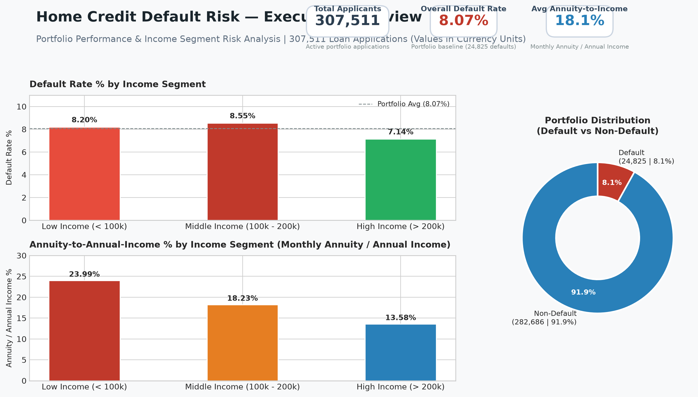
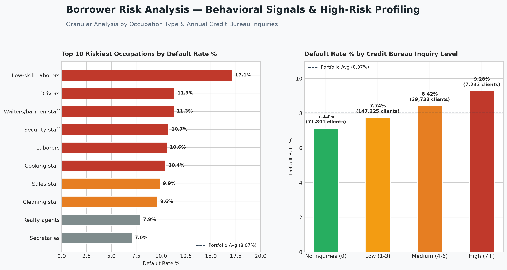

# Power BI Credit Risk Dashboard Documentation

## Executive Summary

The Power BI dashboard (`credit_risk_dashboard.pbix`) provides interactive monitoring and diagnostic drill-downs into the credit risk performance of **307,511 loan applications** from the Home Credit Default Risk dataset.

It is structured into two core analytical views:
1. **Page 1: Credit Risk Overview** — High-level portfolio KPIs, default distribution, and income segment payment-burden metrics.
2. **Page 2: Behavioral Risk Signals** — Granular default risk breakdowns across occupation categories and credit bureau inquiry frequency.

---

## Dashboard Architecture & Views

> **Note on Visual Previews:** The figures below are **illustrative layout previews** reconstructed directly from the Power BI report specifications, data model schema, and underlying portfolio metrics. The live, interactive report is preserved in [`credit_risk_dashboard.pbix`](credit_risk_dashboard.pbix). All monetary quantities reflect dataset currency units as provided in the source competition data.

### Page 1: Credit Risk Overview


#### Visual Elements:
* **KPI Card 1: Total Applicants**
  * *Metric:* `307,511`
  * *Context:* Total evaluated active portfolio loan applications.
* **KPI Card 2: Overall Default Rate**
  * *Metric:* `8.07%` (24,825 defaults)
  * *Context:* Observed baseline portfolio default rate across all applicants.
* **KPI Card 3: Avg Annuity-to-Annual-Income Ratio**
  * *Metric:* `18.1%` (Calculated as `AMT_ANNUITY / AMT_INCOME_TOTAL * 100`)
  * *Context:* Evaluates the size of a single monthly installment (`AMT_ANNUITY`) relative to total annual income (`AMT_INCOME_TOTAL`).
* **Clustered Bar Chart: Default Rate % by Income Segment**
  * Low Income (< 100,000): **8.20%**
  * Middle Income (100,000 - 200,000): **8.55%**
  * High Income (> 200,000): **7.14%**
* **Clustered Bar Chart: Annuity-to-Annual-Income % by Income Segment**
  * Low Income: **23.99%**
  * Middle Income: **18.23%**
  * High Income: **13.58%**
* **Donut Chart: Portfolio Distribution**
  * Non-Default (`TARGET = 0`): `282,686` (91.9%)
  * Default (`TARGET = 1`): `24,825` (8.1%)

---

### Page 2: Behavioral Risk Signals


#### Visual Elements:
* **Horizontal Bar Chart: Top 10 Riskiest Occupations by Default Rate %**
  * Includes a benchmark reference line at **8.07%** (portfolio baseline).
  * *Low-skill Laborers:* **17.15%** (2.1x portfolio baseline)
  * *Drivers:* **11.33%**
  * *Waiters/barmen staff:* **11.28%**
  * *Security staff:* **10.74%**
  * *Laborers:* **10.58%**
  * *Cooking staff:* **10.44%**
  * *Sales staff:* **9.87%**
  * *Cleaning staff:* **9.61%**
* **Column Chart: Default Rate % by Credit Bureau Inquiry Level**
  * Evaluates inquiries during the preceding 12 months (`AMT_REQ_CREDIT_BUREAU_YEAR`).
  * *No Inquiries (0):* **7.13%** (71,801 clients)
  * *Low (1–3):* **7.74%** (147,225 clients)
  * *Medium (4–6):* **8.42%** (39,733 clients)
  * *High (7+):* **9.28%** (7,233 clients)

---

## Understanding the Payment-Burden Metric

A critical technical distinction in this dataset involves the definition of `AMT_ANNUITY` and `AMT_INCOME_TOTAL`:
* **`AMT_INCOME_TOTAL`**: Represents total declared **annual income** of the applicant.
* **`AMT_ANNUITY`**: Represents the loan annuity, which in the Home Credit consumer lending dataset is the **monthly loan installment** due.
* **Metric Definition:** The ratio `(AMT_ANNUITY / AMT_INCOME_TOTAL) * 100` measures **one monthly installment as a percentage of total annual income**.
* **Interpretation:** 
  * For low-income borrowers, an average ratio of **23.99%** indicates that **a single monthly payment consumes nearly a quarter of their annual income**. 
  * If annualized (multiplying the monthly annuity by 12), the annual debt service obligation would be `23.99% * 12 = 287.9%` of annual income if sustained for 12 months, highlighting acute debt overhang.
  * To avoid misleading labeling, this metric is formally designated as the **Annuity-to-Annual-Income Ratio** rather than a simple monthly budget share.

---

## DAX Measures & Calculated Columns

The dashboard relies on the following DAX calculations:

### Key Measures
```dax
Total Clients = 
COUNTROWS('credit_risk_powerbi')

Total Defaults = 
CALCULATE(
    COUNTROWS('credit_risk_powerbi'),
    'credit_risk_powerbi'[TARGET] = 1
)

Default Rate % = 
DIVIDE([Total Defaults], [Total Clients], 0) * 100

Avg Annuity to Income % = 
AVERAGE('credit_risk_powerbi'[fee_to_income_pct])

Avg Credit Amount = 
AVERAGE('credit_risk_powerbi'[AMT_CREDIT])

Avg Annuity Amount = 
AVERAGE('credit_risk_powerbi'[AMT_ANNUITY])
```

### Calculated Columns
```dax
fee_to_income_pct = 
DIVIDE('credit_risk_powerbi'[AMT_ANNUITY], 'credit_risk_powerbi'[AMT_INCOME_TOTAL], 0) * 100

income_segment = 
SWITCH(
    TRUE(),
    'credit_risk_powerbi'[AMT_INCOME_TOTAL] < 100000, "Low Income",
    'credit_risk_powerbi'[AMT_INCOME_TOTAL] <= 200000, "Middle Income",
    "High Income"
)

default_label = 
IF('credit_risk_powerbi'[TARGET] = 1, "Default", "No Default")

inquiries_tier = 
SWITCH(
    TRUE(),
    ISBLANK('credit_risk_powerbi'[AMT_REQ_CREDIT_BUREAU_YEAR]), "Unknown",
    'credit_risk_powerbi'[AMT_REQ_CREDIT_BUREAU_YEAR] = 0, "No Inquiries",
    'credit_risk_powerbi'[AMT_REQ_CREDIT_BUREAU_YEAR] <= 3, "Low Inquiries (1-3)",
    'credit_risk_powerbi'[AMT_REQ_CREDIT_BUREAU_YEAR] <= 6, "Medium Inquiries (4-6)",
    "High Inquiries (7+)"
)
```

---

## Attribution, Licensing & Independent Build Guide

### Upstream Attribution
The dashboard design concept, KPI cards, and two-page visual structure were originally conceived by **Estefania Marcel** ([tefimarcel/credit-risk-analysis](https://github.com/tefimarcel/credit-risk-analysis)). The original repository was published without an explicit root open-source license. The file `credit_risk_dashboard.pbix` is preserved here for non-commercial educational review and demonstration with attribution.

### Independent Dashboard Recreation (Clean-Room Workflow)
For users who prefer to build or deploy the dashboard completely independently without redistributing third-party binaries:
1. **Generate Data Source:**
   * Run the data preparation cell in [`notebooks/credit_risk_analysis.ipynb`](../notebooks/credit_risk_analysis.ipynb).
   * This exports `data/credit_risk_powerbi.csv` (307,511 rows containing all necessary attributes and calculated columns).
2. **Import into Power BI Desktop:**
   * Open Power BI Desktop (free download for Windows).
   * Select **Get Data > Text/CSV** and select `credit_risk_powerbi.csv`.
   * Click **Load**.
3. **Add DAX Measures:**
   * In the modeling tab, create the measures listed in the [DAX Measures](#dax-measures--calculated-columns) section above.
4. **Recreate Visuals:**
   * **Page 1:** Add 3 KPI Cards (`Total Clients`, `Default Rate %`, `Avg Annuity to Income %`), two clustered bar charts for `Default Rate %` and `Avg Annuity to Income %` by `income_segment`, and a donut chart for `default_label`.
   * **Page 2:** Add a horizontal bar chart of `Default Rate %` by `OCCUPATION_TYPE` (top 10 filtered with constant reference line at 8.07%) and a column chart of `Default Rate %` by `inquiries_tier`.
5. **Save:** Save the file as your own independent `.pbix` report.
